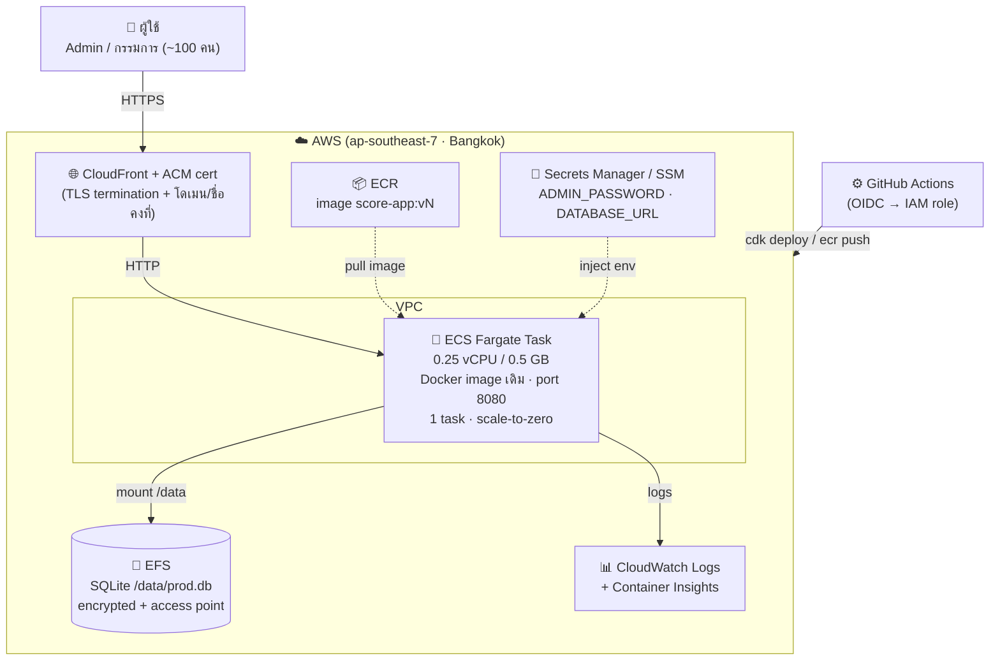

# 10 — สถาปัตยกรรม score-app บน AWS (ออกแบบ)

> สถานะ: **ข้อเสนอการออกแบบ (ยังไม่ลงมือ implement)** — จัดทำ 2026-10-22
> คู่กับ: [`08-aws-migration-proposal.md`](08-aws-migration-proposal.md) (ข้อเสนอเชิงนโยบาย) และ [`11-aws-cost-inputs.md`](11-aws-cost-inputs.md) (ข้อมูลสำหรับทำ cost)
> เป้าหมายเอกสารนี้: อธิบาย **สถาปัตยกรรมปลายทางบน AWS** + เหตุผลการออกแบบ (design decisions) + best practice + trade-off
> เพื่อใช้เป็นฐานให้ทีม Presale นำไปประเมินค่าใช้จ่าย และให้ทีมพัฒนาใช้อ้างอิงตอน implement

---

## 1. ขอบเขตและเงื่อนไขที่ยืนยันแล้ว

| หัวข้อ | ข้อสรุป |
|--------|---------|
| เป้าหมาย | ย้าย score-app จาก Azure Container Apps → AWS |
| ปริมาณผู้ใช้ | ~100 user (โหลดต่ำ, ใช้เฉพาะช่วงมีการแข่งขัน) |
| Load Balancer | **ไม่ใช้** — โหลดต่ำ ไม่คุ้มค่าคงที่ของ ALB |
| ฐานข้อมูล | **เริ่มใหม่** บน AWS (ไม่ย้าย `prod.db` เดิมจาก Azure) — คง SQLite |
| IaC | **AWS CDK (TypeScript)** — เข้ากับ stack ทีม (TS ทั้ง FE/BE) |
| รูปแบบใช้งาน | เปิดระบบเฉพาะช่วงงาน (scale-to-zero) เพื่อประหยัดสูงสุด |
| Admin login | shared password ตัวเดียว เก็บใน Secrets Manager/SSM (ดู `09-next-phase-security.md`) |
| กรรมการ | เข้าได้เลยผ่านลิงก์ token เดิม — **ไม่แตะ** |
| Region | `ap-southeast-7` (Bangkok, ไทย) — data residency ในไทย, latency ต่ำสุด (GA, 3 AZ) |

> **หลักการ:** ไม่แก้ตรรกะตัวแอป (`backend/`, `frontend/`) — เปลี่ยนเฉพาะ infrastructure + CI/CD + การ inject config ผ่าน env

---

## 2. สถาปัตยกรรมภาพรวม



> **หมายเหตุ CloudFront:** เป็น *คำแนะนำ* เพื่อให้ได้ HTTPS + ชื่อ/โดเมนคงที่ (Fargate public IP เปลี่ยนทุกครั้งที่ restart)
> ช่วง UAT แรกสามารถข้ามไปใช้ HTTP ตรงที่ public IP ก่อนได้ (ดู §6 trade-off)
> ในเอกสาร cost จะแยกรายการ CloudFront ไว้เป็น optional

---

## 3. องค์ประกอบ (AWS Services) และบทบาท

| Service | บทบาทในระบบ | เทียบกับ Azure เดิม |
|---------|-------------|---------------------|
| **ECS Fargate** | รัน Docker container (แอปเดิม) แบบ serverless — ไม่ดูแล EC2 | = Azure Container Apps |
| **EFS** (Elastic File System) | เก็บไฟล์ SQLite `prod.db` ถาวร (NFS) | = Azure Files |
| **ECR** (Elastic Container Registry) | เก็บ Docker image `score-app:vN` | = Azure Container Registry (ACR) |
| **CloudFront** *(แนะนำ)* | CDN หน้า task — TLS/HTTPS + โดเมนคงที่ แทน LB | = ingress HTTPS ของ ACA |
| **ACM** | ออก TLS certificate (ฟรี) ให้ CloudFront | = cert ที่ ACA จัดการให้ |
| **Secrets Manager / SSM Parameter Store** | เก็บ `ADMIN_PASSWORD`, `DATABASE_URL` | = ACA secrets/env |
| **CloudWatch Logs** | เก็บ log ของ container | = log stream ของ ACA |
| **IAM (OIDC)** | ให้ GitHub Actions assume role deploy ได้โดยไม่เก็บ key ถาวร | = Service Principal + AZURE_CREDENTIALS |
| **VPC / Subnet / Security Group** | เครือข่าย + กฎ firewall คุม inbound/outbound | (ACA จัดการให้ภายใน) |

---

## 4. Design Decisions (เหตุผลการออกแบบ)

### 4.1 ทำไม ECS Fargate (ไม่ใช่ App Runner / EC2 / RDS)
- **Fargate scale-to-zero ได้** → ไม่มีงานไม่จ่ายค่าประมวลผล ตรงเป้า "ประหยัดสุด"
- รองรับ **mount EFS** → เก็บ SQLite แบบเดิมได้ ไม่ต้องแปลงฐานข้อมูล
- App Runner ต้องเปิดขั้นต่ำ 1 instance ตลอด + แนบ persistent storage ไม่ได้ → ใช้ SQLite ไม่ได้
- RDS/Aurora ต้องเปิดตลอด = ค่าคงที่รายเดือน + ต้องแปลงเป็น PostgreSQL → ขัดเป้าประหยัดและเพิ่มงาน/ความเสี่ยง
- (รายละเอียดเปรียบเทียบเต็มอยู่ใน [`08-aws-migration-proposal.md`](08-aws-migration-proposal.md) §4)

### 4.2 ทำไมไม่มี Load Balancer
- ผู้ใช้ ~100 คน โหลดต่ำ ใช้เป็นครั้งคราว → ALB มีค่าคงที่รายชั่วโมง (เสียเงินแม้ไม่มีงาน) ไม่คุ้ม
- ใช้ **Fargate task public IP + Security Group คุมเข้ม** แทน
- เติม **CloudFront** หน้า task เพื่อได้ HTTPS + ชื่อคงที่ (CloudFront คิดตามใช้จริง ไม่มีค่าคงที่แบบ ALB)

### 4.3 ทำไมยังใช้ SQLite (ไม่ย้าย RDS)
- ข้อมูลเล็ก (ไม่กี่ MB), ตัวเขียนเดียว, โหลดต่ำ → SQLite เพียงพอและถูกที่สุด
- เก็บบน EFS ได้ความถาวร (ข้อมูลไม่หายแม้ scale-to-zero)
- **บันทึกเป็น known trade-off:** ถ้าโหลดโตมากในอนาคต ค่อยยกไป RDS/Aurora Serverless v2 ได้ โดยเปลี่ยน Prisma provider (ไม่ต้องรื้อระบบ)

### 4.4 ทำไม AWS CDK (ไม่ใช่ Terraform / คลิก console)
- ทีมใช้ **TypeScript** อยู่แล้ว → เขียน/ดูแล IaC ด้วยคนเดิม ไม่ต้องเรียน HCL
- งานนี้ **AWS-only** (ไม่ multi-cloud) → จุดแข็ง multi-provider ของ Terraform ไม่ได้ใช้
- `cdk diff` ดู change ก่อน deploy ได้ชัด + reproducible (ไม่คลิกมือหลุด)
- **Trade-off:** CDK ผูกกับ CloudFormation (AWS เท่านั้น) — แต่โจทย์คือย้ายมา AWS แล้วปิด Azure จึงไม่ต้องการ portability ข้าม cloud

### 4.5 ทำไม OIDC สำหรับ CI/CD
- GitHub Actions ขอ token ชั่วคราวจาก AWS ผ่าน **OIDC trust** → **ไม่ต้องเก็บ access key ถาวร** เป็น secret
- ตรงหลัก "ไม่เก็บรหัสลับถาวร" (doc 08 §6.3) และลดความเสี่ยง key หลุด

---

## 5. Best Practice ที่ออกแบบไว้

- **IAM least privilege:** แยก **task role** (สิทธิ์ runtime เช่นอ่าน Secrets) ออกจาก **execution role** (pull ECR / ส่ง log) — ให้สิทธิ์เท่าที่จำเป็น
- **Secrets:** `ADMIN_PASSWORD`, `DATABASE_URL` เก็บใน Secrets Manager/SSM — ไม่ hardcode ใน image / task definition
- **Encryption:** EFS เปิด encryption at rest; TLS in transit ผ่าน CloudFront (ACM)
- **EFS Access Point:** จำกัด path + POSIX uid/gid ที่ container เข้าถึง (ไม่เปิดทั้ง filesystem)
- **Security Group:** inbound เปิดเฉพาะ port ที่จำเป็น (443 ผ่าน CloudFront / 8080 จากต้นทางที่กำหนด), outbound เท่าที่ต้อง (pull image/secret)
- **Observability:** CloudWatch Logs + Container Insights; ตั้ง **AWS Budgets + alert** กันค่าใช้จ่ายบานปลาย
- **IaC ทั้งหมด:** นิยามใน CDK, เก็บใน repo (`deploy/aws/`) — reproducible, review ผ่าน PR ได้
- **Deploy ผูกกับ git tag `v*`** เหมือน Azure เดิม (รักษา release workflow ทีมที่ doc 07 วางไว้)
- **1 task เท่านั้น** (`desiredCount` สูงสุด 1) — เงื่อนไขของ SQLite ตัวเขียนเดียว (ดู §6.1)

---

## 6. Trade-off และข้อจำกัดที่รับทราบ (ต้องสื่อสาร)

### 6.1 SQLite + EFS → ต้องจำกัด 1 task
> [!WARNING]
> EFS เป็น **NFS** (ต่างจาก Azure Files ที่เป็น SMB) — พฤติกรรม file lock ต่างกัน
> ต้อง **พิสูจน์ใน UAT** ว่า SQLite ไม่เจอ `database is locked` และยังต้องจำกัด **1 task เขียนเดียว**
> ถ้าต้องหลายตัว/โหลดสูง → ต้องย้าย RDS (มีค่าใช้จ่าย) — นี่คือ **ความเสี่ยงเทคนิคอันดับ 1** ของการย้าย

### 6.2 ต้อง "เปิดระบบ" ก่อนใช้งาน
- scale-to-zero ประหยัด แต่ครั้งแรกที่มีทราฟฟิกหลังพัก task ต้อง cold start (~10–30 วิ)
- ต้องมี **checklist/สคริปต์เปิดระบบก่อนงาน** และสื่อสารกับผู้ใช้ (ดู doc 08 §7)

### 6.3 Public IP เปลี่ยนเมื่อ task restart
- ถ้า **ไม่ใช้ CloudFront** → IP เปลี่ยนทุก restart ลิงก์กรรมการจะเปลี่ยนตาม (กระทบ UX)
- **ทางแก้ที่แนะนำ:** CloudFront (หรือ Route53/CloudMap) อยู่หน้า เพื่อตรึงชื่อ

### 6.4 URL เปลี่ยนจาก Azure
- ลิงก์เดิมของ Azure ใช้ไม่ได้หลัง cut-over → ต้องแจกลิงก์กรรมการใหม่ (ดู doc 08 §7)

### 6.5 เริ่มฐานข้อมูลใหม่
- ไม่ย้ายข้อมูลเก่า → การแข่งขันเดิมจะไม่อยู่บน AWS (ตามที่ตกลง) ถ้าต้องเก็บ ให้ Export Excel ก่อน

---

## 7. โครงสร้าง repo ที่เสนอ (ไม่แยก project)

> ใช้ **repo เดียว** + feature branch `feat/aws-migration` — ตัวแอปเป็น source of truth เดียว
> แยกเฉพาะ **infra** ตาม platform เพื่อให้ Azure เป็น fallback ได้จน cut-over เสร็จ

```
score-app/
├─ backend/   frontend/          # โค้ดแอป — ไม่ผูก platform (ไม่แตะตรรกะ)
├─ deploy/
│  ├─ azure/                     # ย้าย app.yaml + az script เดิมมารวม
│  └─ aws/                       # ใหม่: CDK (TS) — ECS/EFS/ECR/IAM/CloudFront
├─ .github/workflows/
│  ├─ deploy-azure.yml           # เดิม (เก็บไว้จน cut-over เสร็จ)
│  └─ deploy-aws.yml             # ใหม่ (OIDC + cdk deploy + ECR push)
└─ docs/
   ├─ 10-aws-architecture.md     # ← เอกสารนี้
   └─ 11-aws-cost-inputs.md      # ข้อมูลสำหรับ Presale ทำ cost
```

---

## 8. สิ่งที่ยังต้องตัดสินใจก่อน implement (ไม่กระทบการทำ cost)

1. **CloudFront** — ใส่จริงตั้งแต่แรก หรือ UAT แรกใช้ HTTP ตรงไปก่อน
2. **โดเมน** — ใช้ชื่อที่ CloudFront/AWS แจกให้ หรือโดเมนองค์กร (ต้องมีโดเมน + ตั้ง DNS)
3. **เครื่องมือเปิด-ปิดระบบ** — สคริปต์ CLI หรือปุ่ม/ช่องทางให้ทีม ops สั่งง่าย

> เอกสารนี้เน้น "ออกแบบ" — รายการ service สำหรับคิดราคาอยู่ใน [`11-aws-cost-inputs.md`](11-aws-cost-inputs.md)

---

## 9. สรุป Scope "เวอร์ชันใหม่บน AWS" (รวมงานทั้งหมดที่จะทำรอบเดียว)

> เพิ่ม 2026-10-22 — ตามที่ตกลง: งานใหม่ทั้งหมดไปทำพร้อมการย้ายขึ้น AWS ใน release เดียว

เวอร์ชันใหม่นี้ประกอบด้วย **การย้าย infra ขึ้น AWS** + งานฟีเจอร์/ความปลอดภัย 4 ข้อ:

| # | งาน | อ้างอิง | ประเมิน (หลวม ๆ เผื่อเวลา) |
|---|-----|---------|:---:|
| 0 | **ย้าย + deploy ขึ้น AWS** (CDK: VPC/ECR/EFS หรือ EBS/Fargate/IAM/CloudFront, Docker/env, CI/CD OIDC, สคริปต์เปิด-ปิด, UAT, cut over) | `08`, `10` §1–8 | ~5–6 วัน |
| 1 | **ป้องกันฝั่ง Admin** (auth รหัสผ่านตัวเดียว) | `09` งานที่ 1 | ~0.5 วัน |
| 2 | **Revoke/เปลี่ยนลิงก์กรรมการ** (ปุ่มใน UI + log) | `09` งานที่ 2 | ~0.3 วัน |
| 3 | **ปรับ UI หน้าแสดงผลคะแนน** (สี + ลำดับ section) | `09` งานที่ 3 | ~0.3 วัน |
| 4 | **FR-25 แนบลิงก์ผลงานต่อทีม** (admin แนบ URL → แสดงเป็นปุ่ม) | `01` FR-25 | ~0.5–1 วัน |
| | **รวมทั้งหมด** | | **~7–8.5 วันทำงาน (≈ 1.5–2 สัปดาห์)** |

### หมายเหตุประกอบ
- **DB บน AWS:** พิจารณาใช้ **EBS แทน EFS** เพื่อเลี่ยงความเสี่ยง SQLite + NFS file lock (ดู §6.1) — คง SQLite ไม่ต้องแก้ตรรกะแอป, ยัง scale-to-zero ได้; ยังไม่ไป RDS (over spec สำหรับโหลดปัจจุบัน — ดู §4.3)
- **env/secrets:** `ADMIN_PASSWORD`, `DATABASE_URL` เก็บใน Secrets Manager/SSM (แทน ACA env เดิมใน `09`)
- **FR-25 จุดที่ต้องเคาะก่อน implement:** ปุ่มลิงก์แสดงที่ไหน — หน้ากรรมการ / หน้าผล admin / หน้า present สด
- งาน 1–4 ไม่พึ่ง AWS โดยตรง (แก้ที่ตัวแอป) แต่รวม release เดียวกันเพื่อ deploy ครั้งเดียวจบ
